  
  
  
  

---

## About

I am a final-year **B.Tech Computer Science** student at **Bennett University** (CGPA **8.17/10**, graduating May 2027), working mostly in **Java and Spring Boot** on the backend and **Python** for AI/ML.

---

## Tech Stack

**Languages**

**Backend**

**Databases**

**Frontend**

**Testing & Tooling**

**AI / ML**

---

## GitHub Stats

<picture>
  <source media="(prefers-color-scheme: dark)" srcset="./profile/stats-dark.svg" />
  <source media="(prefers-color-scheme: light)" srcset="./profile/stats-light.svg" />
  
</picture>
<picture>
  <source media="(prefers-color-scheme: dark)" srcset="./profile/top-langs-dark.svg" />
  <source media="(prefers-color-scheme: light)" srcset="./profile/top-langs-light.svg" />
  
</picture>

 

<picture>
  <source media="(prefers-color-scheme: dark)" srcset="./profile/streak-dark.svg" />
  <source media="(prefers-color-scheme: light)" srcset="./profile/streak-light.svg" />
  
</picture>

---

## Featured Projects

### Pramaan: answers with proof from your documents

Pramaan (प्रमाण, "proof") is a document platform for a university. Staff upload PDFs, and students and faculty ask questions in plain language. Every answer cites the exact page it came from, and when the documents do not support an answer it says so instead of guessing.

| | |
|---|---|
| **Citations that cannot be invented** | The model may only cite passages it was handed, and every title and page number is read back from the database rather than taken from the model. A citation either resolves to a real page or it does not survive to the answer. |
| **Permissions inside the query** | Access rules live in the database query itself, so a document a user may not read is never searched, never counted and never sent to the model. Authorisation cannot be forgotten at a call site because there is no call site to forget it at. |
| **Refusing is a feature** | When the retrieved passages do not support an answer, Pramaan returns "no answer found". A confident wrong answer about an exam regulation is worse than no answer. |
| **Hybrid retrieval, local embeddings** | pgvector for meaning and keyword search for exact terms, with `qwen3-embedding:0.6b` running locally in Ollama, so document text is never shipped out to be embedded. |
| **Tested against fakes** | JUnit, Testcontainers, Vitest and Playwright run in CI against fake AI models, so the suite never calls a paid API and never flakes on someone else's uptime. |

Roles for student, faculty and admin, document sharing per role or per person, summaries with page references, two-document comparison, and an audit log that records actions without ever storing passwords, questions or document text.

### CodeNav AI: ask an unfamiliar codebase questions in English

A local RAG assistant. Clone any public repo, index it, then ask about it in plain English and get back the relevant code with file paths and line numbers.

- **AST-based chunking.** Python is split along real function and class boundaries rather than fixed-size blocks, so retrieved context arrives complete instead of severed mid-body.
- **Persistent FAISS index.** Opening a cached codebase dropped from **over 20 seconds to under 0.1**, a 99.5% improvement, by writing the index to disk instead of rebuilding it per session.
- **Smart refresh.** A `git pull` on the cached repo skips reindexing entirely when nothing changed.

### BillSync: group expense splitter

Members log what they paid, and BillSync works out who owes whom, then collapses that into the fewest sensible payments.

| | |
|---|---|
| **Exact-paisa splits** | Base share rounds down, the remainder is handed out one paisa at a time in ascending user-id order. Shares sum to the total exactly, never approximately, and the result is deterministic whatever order the client listed participants in. |
| **Debt simplification** | Greedy max-heap pairing of the largest creditor with the largest debtor. A 5-member group with 8 outstanding debts settles in 4 transfers, with a proven bound of at most n − 1. |
| **Money never touches a float** | `NUMERIC(12,2)` in Postgres, `BigDecimal` in Java, a string on the wire. |
| **Scale** | 16 REST endpoints, 6 tables under Flyway migrations, 73 automated tests. One slow screen went from 22 queries to 1 via `@EntityGraph`. |

---

## Achievements

| | |
|---|---|
| **Smart India Hackathon 2024** | Ranked **101st nationally** |
| **LeetCode** | Contest rating **1500+** |
| **CodeChef** | **2-star** rated |
| **Hackaccino 2024** | Competed, Bennett University |

---

## Education & Certifications

**B.Tech, Computer Science and Engineering** — Bennett University, Greater Noida · Aug 2023 – May 2027 · **CGPA 8.17/10**

Coursework: Data Structures & Algorithms, Object-Oriented Programming, DBMS, Operating Systems, Computer Networks, Deep Learning, Neural Networks, System Design.

<strong>Certifications</strong>

 

- **Build Basic Generative Adversarial Networks (GANs)** — DeepLearning.AI via Coursera, Apr 2026
- **Neural Networks and Deep Learning** — DeepLearning.AI via Coursera, Apr 2025
- **Machine Learning: Clustering & Retrieval** — University of Washington via Coursera, Nov 2024

<strong>Research & Talks</strong>

 

**Agreement Loops in Multi-Agent Systems** — seminar talk, 2026. A literature review of how independent AI agents reach agreement with one another, covering what works today and what remains open.

---

### Get in touch

Open to **backend and AI/ML internships**. The fastest way to reach me is email.

  

